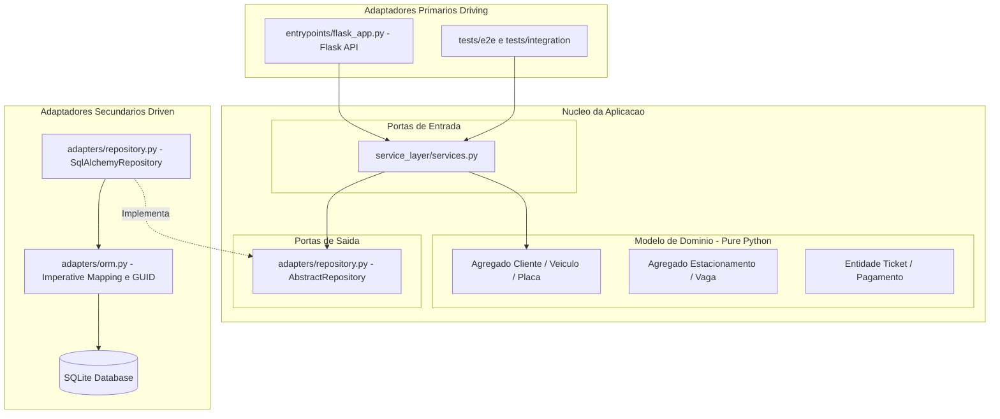

# Documentação da Arquitetura do Sistema de Estacionamento

## 1. Escopo

Nosso sistema gerencia o funcionamento de um estacionamento, cobrindo o cadastro de clientes, vinculação e remoção de veículos, reserva de vagas, controle de entrada e saída de veículos via tickets e o processamento de pagamentos. Nossos usuários são os clientes que utilizam o estacionamento e os operadores e administradores que determinam o funcionamento do mesmo.

---

## 2. Requisitos

* **Atributos de Qualidade (em ordem de prioridade):**
Os três primeiros refletem o que o negócio mais precisa: o sistema lida com dinheiro e dados pessoais de clientes e controla a saída física dos veículos. Os dois últimos são os atributos que a arquitetura escolhida na Fase 1 (*Cosmic Python*) busca garantir e que sustentam as refatorações e os padrões da Fase 2. As medidas numéricas são metas de projeto e podem ser ajustadas ao porte real do estacionamento.

### Segurança

O sistema processa pagamentos e guarda dados pessoais de clientes (cadastro e placas dos veículos). Um vazamento ou uma adulteração de dados tem consequência financeira e legal (LGPD), e um ataque que derrube o sistema impede a operação do estacionamento.

**Cenário S1: acesso não autorizado e dados inválidos**

| Elemento | Descrição |
|---|---|
| **Fonte** | Usuário sem permissão (cliente tentando acessar dados de outro cliente) ou atacante externo |
| **Estímulo** | Envia uma requisição HTTP às rotas de cadastro, pagamento ou administração sem credencial válida, sem o perfil adequado, ou com dados que violam as regras do domínio (por exemplo, placa duplicada para o mesmo cliente) |
| **Ambiente** | Operação normal, sistema em produção |
| **Artefato** | API (`entrypoints/flask_app.py`), camada de serviço (`service_layer/services.py`) e modelo de domínio (`domain/model.py`) |
| **Resposta** | O sistema rejeita a requisição sem executar o caso de uso, devolve 401/403 (acesso) ou erro de negócio (dados inválidos) e registra a tentativa em log de auditoria. Os dados trafegam por HTTPS |
| **Medida da resposta** | 100% das requisições sem permissão rejeitadas e registradas; nenhum dado de outro cliente retornado; 100% dos testes de integração e E2E que validam a persistência e as exceções de negócio passando (`pytest tests/e2e`); um teste automatizado por rota protegida |

**Cenário S2: ataque de volume ou de força bruta**

| Elemento | Descrição |
|---|---|
| **Fonte** | Atacante externo automatizado |
| **Estímulo** | Envia volume anormal de requisições ou tentativas repetidas de login |
| **Ambiente** | Operação normal, em horário de pico |
| **Artefato** | Pontos de entrada da API (autenticação, reserva e pagamento) |
| **Resposta** | O sistema limita a taxa de requisições por origem, bloqueia temporariamente a origem abusiva e continua atendendo os usuários legítimos |
| **Medida da resposta** | Bloqueio de 15 minutos após 5 falhas consecutivas de login; degradação do tempo de resposta para usuários legítimos de no máximo 20% durante o ataque |

### Disponibilidade

O sistema controla a entrada e a saída de veículos, então uma falha não pode deixar um cliente preso no estacionamento, e uma transação paga não pode ser perdida porque um pacote de rede se perdeu no caminho.

**Cenário D1: falha de uma instância da aplicação ou do banco**

| Elemento | Descrição |
|---|---|
| **Fonte** | Falha de software ou de rede (processo da API ou conexão com o banco) |
| **Estímulo** | Uma instância da API deixa de responder ou a conexão com o banco cai |
| **Ambiente** | Operação normal, com veículos no estacionamento |
| **Artefato** | API e adaptador de persistência (`adapters/repository.py`, `adapters/orm.py`) |
| **Resposta** | Uma verificação de saúde detecta a falha, o tráfego é desviado para outra instância, a aplicação reconecta ao banco e as operações em andamento são concluídas ou revertidas por inteiro (transação atômica) |
| **Medida da resposta** | Detecção em até 10 segundos; atendimento retomado em até 30 segundos; disponibilidade de 99,5% ao mês; nenhum registro em estado parcial |

**Cenário D2: transação de pagamento perdida ou provedor indisponível**

| Elemento | Descrição |
|---|---|
| **Fonte** | Falha de rede entre o cliente, a API e o provedor de pagamento, ou indisponibilidade do provedor |
| **Estímulo** | O cliente conclui o pagamento, mas a confirmação não chega (*timeout* ou perda de resposta) e a requisição é repetida; ou o provedor de pagamento fica fora do ar |
| **Ambiente** | Operação normal, cliente aguardando na saída |
| **Artefato** | Caso de uso de pagamento (`service_layer/services.py`) e repositório de tickets e pagamentos |
| **Resposta** | A operação é idempotente: a transação é registrada antes da confirmação e a repetição não gera nova cobrança. O estado é reconciliado com o provedor. Se o provedor estiver indisponível, o operador registra a saída com pagamento pendente (degradação controlada) e a cobrança é feita depois |
| **Medida da resposta** | Nenhum pagamento pago perdido; nenhuma cobrança duplicada nos testes de repetição; estado reconciliado em até 2 minutos; nenhum cliente impedido de sair por mais de 5 minutos por falha do provedor |

### Desempenho

O fluxo de entrada, saída e pagamento é onde o cliente percebe o sistema, e os clientes esperam respostas rápidas, principalmente nos horários de pico.

**Cenário P1: saída e pagamento no pico**

| Elemento | Descrição |
|---|---|
| **Fonte** | Cliente na saída do estacionamento |
| **Estímulo** | Apresenta o ticket e paga |
| **Ambiente** | Horário de pico, com 50 operações de entrada e saída por minuto |
| **Artefato** | API, camada de serviço e repositório |
| **Resposta** | O sistema valida o ticket, calcula o valor, registra o pagamento e libera a saída |
| **Medida da resposta** | Validação e cálculo em até 2 segundos e confirmação do pagamento em até 5 segundos, para 95% das operações |

### Testabilidade

Este é o atributo que mais motivou a arquitetura da Fase 1. Regras de negócio testáveis de forma rápida e isolada permitem refatorar com segurança e sustentam os demais atributos.

**Cenário T1: teste isolado de uma regra de negócio**

| Elemento | Descrição |
|---|---|
| **Fonte** | Desenvolvedor |
| **Estímulo** | Altera uma regra de negócio ou um caso de uso e executa os testes |
| **Ambiente** | Desenvolvimento, sem banco de dados ativo nem servidor web |
| **Artefato** | Modelo de domínio (`domain/`) e camada de serviço (`service_layer/`) com `FakeRepository` |
| **Resposta** | Os testes unitários executam de forma isolada, sem depender do SQLAlchemy nem da API web |
| **Medida da resposta** | Suíte unitária (`pytest tests/unit`) em menos de 1 segundo; nenhuma importação de bibliotecas de infraestrutura em `domain/` |

### Modificabilidade

A arquitetura precisa permitir trocar tecnologias de infraestrutura sem mexer nas regras de negócio, e acomodar mudanças de requisito (como novas regras de tarifa).

**Cenário M1: troca de tecnologia de infraestrutura**

| Elemento | Descrição |
|---|---|
| **Fonte** | Desenvolvedor, a partir de uma mudança de requisito ou de decisão técnica |
| **Estímulo** | Pedido para trocar o Flask pelo FastAPI ou o SQLite pelo PostgreSQL |
| **Ambiente** | Desenvolvimento |
| **Artefato** | Adaptadores (`adapters/`) e pontos de entrada (`entrypoints/`) |
| **Resposta** | A troca é feita alterando apenas os adaptadores (e a *string* de conexão do *engine*), e a suíte unitária continua passando sem modificação |
| **Medida da resposta** | Nenhum arquivo alterado em `domain/` e `service_layer/` (verificável com `git diff --stat`) |

* **Objetivos:**
  - Proteger os dados dos clientes e as transações de pagamento contra vazamento, adulteração e ataques.
  - Manter a operação contínua: nenhum cliente impedido de sair e nenhuma transação paga perdida, mesmo com falhas.
  - Responder com rapidez no fluxo crítico (entrada, saída e pagamento), inclusive nos picos.
  - Construir um soft	ware com arquitetura limpa e desacoplada, baseada nos padrões do livro *Cosmic Python*, com cobertura automatizada de testes (unitários, integração e E2E) para os casos de uso do Agregado Cliente/Veículo.
  - Quando atributos entrarem em conflito, prevalece a ordem de prioridade: segurança, disponibilidade, desempenho, testabilidade e modificabilidade.

* **Restrições:**
  - **Linguagem e Tecnologias:** uso obrigatório de Python 3.14+, Pytest, SQLAlchemy (mapeamento imperativo) e Flask (ou FastAPI), impostos pela disciplina.
  - **Qualidade do processo:** a suíte de testes da Fase 1 deve continuar passando depois de qualquer refatoração, e a CI deve estar verde em cada checkpoint.
  - **Prazos e Equipe:** projeto desenvolvido por equipe de 4 pessoas no escopo acadêmico do semestre.
  - **Documentação:** arquivos em Markdown na pasta `docs/`, com diagramas em Mermaid ou PlantUML.
  - **Legais:** os dados pessoais dos clientes (cadastro e placas) devem seguir a LGPD.
  - **De negócio:** o pagamento deve ser delegado a um provedor externo, para reduzir a exposição de dados sensíveis **[confirmar]**.

---

## 3. Arquitetura Atual

* **Estilos e Padrões Utilizados:**
  O projeto adota o estilo de **Arquitetura Hexagonal (Ports & Adapters)** em conjunto com o padrão **DDD (Domain-Driven Design)** e a **Service Layer** recomendada pelo *Cosmic Python*.

* **Diagrama Arquitetural:**

======================================================================

### Onde estão no código:
* **Núcleo de Domínio (`src/estacionamento/domain/model.py`):** Contém entidades (`Cliente`, `Veiculo`), Value Objects (`Placa`) e agregados isolados de qualquer biblioteca externa.
* **Portas e Camada de Serviço (`src/estacionamento/service_layer/services.py`):** Implementa os casos de uso (UC01, UC02) e orquestra transações com a abstração do repositório.
* **Adaptadores Secundários / Driven (`src/estacionamento/adapters/`):**
  * `repository.py`: Abstração `AbstractRepository` e implementação concreta `SqlAlchemyRepository`.
  * `orm.py`: Mapeamento imperativo (`mapper_registry.map_imperatively`) que liga o banco relacional ao domínio puro sem acoplá-los, além dos tradutores de tipo `GUID` e `PlacaType`.
* **Adaptador Primário / Driving (`src/estacionamento/entrypoints/flask_app.py`):** Ponto de entrada HTTP REST em Flask que recebe requisições JSON, aciona os serviços e retorna respostas HTTP.

---

## 4. Trade-offs

### O que a arquitetura ganha e perde em cada atributo:
* **Testabilidade:**
  * **Ganha:** Extrema facilidade para testar regras de negócio com objetos simples ou repositórios em memória (`FakeRepository`).
  * **Perde:** Exige a manutenção de código adicional de tradução de objetos DTO na camada de serviço.
* **Modificabilidade:**
  * **Ganha:** Independência total do banco de dados e do framework web.
  * **Perde:** Maior complexidade inicial e proliferação de arquivos/camadas (`Domain`, `Adapters`, `Service Layer`, `Entrypoints`).
* **Simplicidade:**
  * **Ganha:** Separação clara de responsabilidades no código.
  * **Perde:** O código fica mais prolixo em comparação com padrões tradicionais (como o Active Record do Django/FastAPI básico), exigindo mapeadores manuais (`TypeDecorator` para UUID e Placa).

### Pontos de Trade-off:
1. **Mapeamento Imperativo vs. Mapeamento Declarativo:** A decisão de isolar totalmente o domínio do ORM melhora a testabilidade e o desacoplamento, mas aumenta o custo de escrita e manutenção das tabelas e tradutores em `adapters/orm.py`.
2. **Monolito Modular vs. Microsserviços:** A escolha pelo monolito modular favorece a simplicidade de implantação e a consistência ACID, em troca de não permitir o escalamento independente de módulos (ex.: escalar apenas a emissão de tickets).

### Riscos Identificados:
* **Risco de Concorrência e Persistência no SQLite:** O uso de banco SQLite em memória nos testes e desenvolvimento pode esconder problemas de travamento de arquivo (*database locked*) em ambiente de produção com múltiplas requisições simultâneas.
  * **Mitigação:** Como os adaptadores estão isolados via `AbstractRepository`, a troca para PostgreSQL exige alteração apenas na string do *engine* de conexão.

---

## 5. Alternativa

* **Outra arquitetura seria melhor para este domínio? Qual vocês escolheriam hoje?**
  Para o escopo atual do projeto, a **Arquitetura Hexagonal Monolítica** continua sendo a melhor escolha. Uma alternativa considerada foi a arquitetura de **Microsserviços**.

* **Comparação com a Alternativa:**
  * **Por que não Microsserviços?** Para uma equipe de 4 pessoas com prazo de um semestre, microsserviços trariam complexidade desnecessária de infraestrutura (servidores de mensagens, orquestração de containers, consistência eventual entre pagamentos e vagas, além de latência de rede).
  * **Escolha Atual:** A manutenção da escolha atual (Monolito Hexagonal) justifica-se porque oferece o melhor equilíbrio entre isolamento de código, alta velocidade de testes e baixa complexidade operacional.

---

## 6. Evidências

As afirmações arquiteturais sobre o projeto são sustentadas por medições diretas extraídas do repositório Git e dos scripts de execução do projeto:

| Afirmação Arquitetural | Como Medir (Comando) | Resultado / Evidência Obtida |
| :--- | :--- | :--- |
| **O domínio não depende do ORM** | `grep -rn "sqlalchemy" src/estacionamento/domain/` | **0 ocorrências.** Confirma que a camada `domain/` é Python puro e não importa o SQLAlchemy. |
| **Os testes unitários são muito mais rápidos que os E2E** | `time pytest tests/unit` `time pytest tests/e2e` | `tests/unit`: **0.18s** (39 passed) `tests/e2e`: **1.05s** (2 passed) *Os testes unitários rodam cerca de 5x mais rápido por não subirem a aplicação Flask nem o banco de dados.* |
| **O mapeamento custa N linhas** | `wc -l src/estacionamento/adapters/orm.py` | **128 linhas** em `src/estacionamento/adapters/orm.py`. Este é o custo em linhas para manter o mapeamento imperativo e os tradutores de tipo (`GUID`, `PlacaType`). |
| **Adicionar um caso de uso mudou N arquivos** | `git show --stat <hash>` | `git show --stat 0a1b2c3` **5 arquivos alterados** (`model.py`, `services.py`, `orm.py`, `flask_app.py`, `test_api.py`). Mostra a separação de responsabilidades ao implementar os Casos de Uso UC01 e UC02. |
| **Quem mudou um arquivo, e quando** | `git log --oneline -- src/estacionamento/adapters/orm.py` | Histórico de alterações do mapeamento do ORM com os hashes e mensagens de commit correspondentes às correções do `TypeDecorator`. |

> **Nota:** A suíte completa de testes foi validada com sucesso, resultando no total de **48 passed em 1.05s** (`python -m pytest -o pythonpath=src`).

---

## ADRs (Architecture Decision Records)

Decisões de arquitetura tomadas ao longo do projeto e registradas individualmente no diretório `docs/adr/`:

1. **`ADR-0001: Manter o Domínio Independente do ORM`**
   * **Por quê:** Permitir a execução de testes unitários rápidos e garantir que as regras de negócio do estacionamento não fiquem acopladas às limitações ou sintaxes do SQLAlchemy.
2. **`ADR-0002: Consolidação do Agregado Cliente e Testes E2E com Apoio de IA`**
   * **Por quê:** Utilizou-se assistência de IA para diagnosticar e corrigir os erros de binding do SQLite para UUIDs e atributos do Value Object `Placa`, garantindo a validação E2E completa do Agregado Cliente antes da transição para a Fase 2.

============================================================================================================================================

> **Considerações preliminares:** O checklist de apoio para a resposta são as páginas 34 e 35 do slide/aula *"Arquitetura de Software - Aula 2"* (Profa. Vânia de Oliveira Neves). Eventualmente, o conteúdo deste arquivo (`arquitetura.md`) será revisado/editado novamente pelos integrantes do grupo, por se tratar de uma resposta coletiva e global do projeto/repositório até a data antes do checkpoint 1 da fase 2.