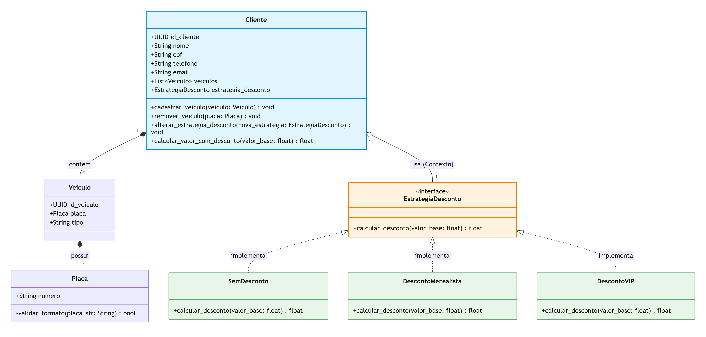
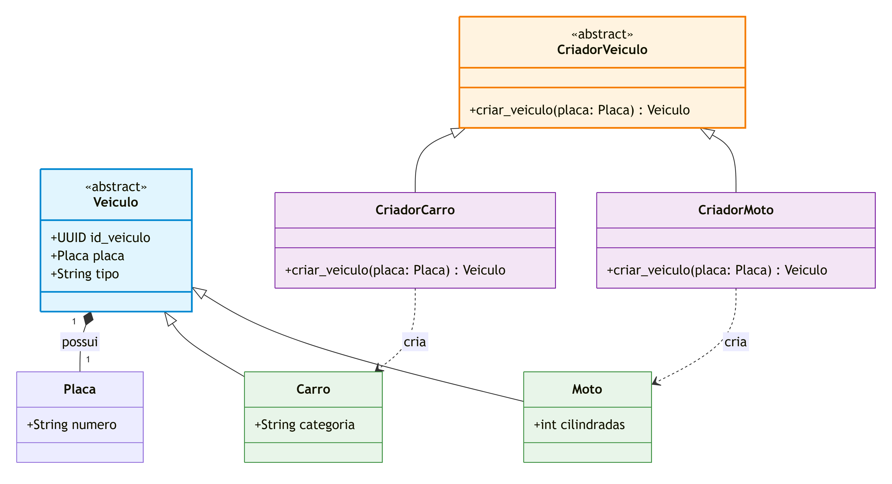
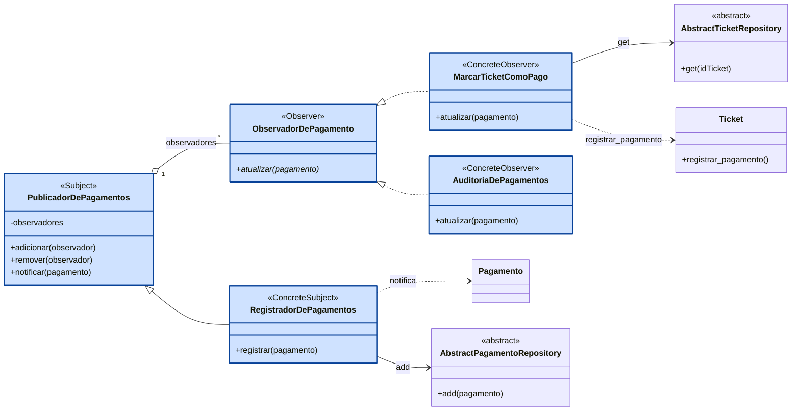
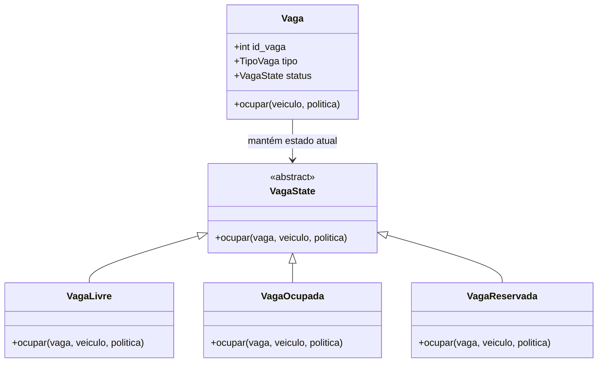
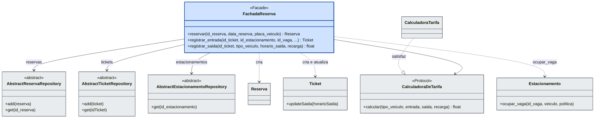
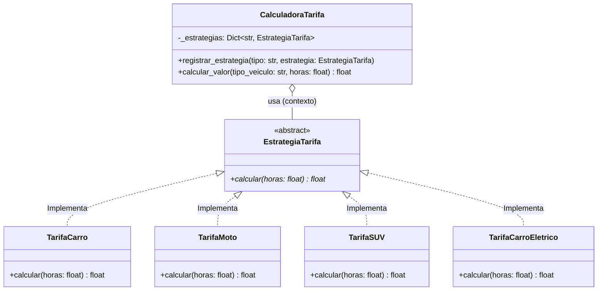

**Agregado Cliente (class raiz cliente): Política de descontos por categoria de cliente (sem desconto - cliente avulso, cliente mensalista - 20%, cliente VIP - 35%).**

**Autor: Kennedy Soares**

**Nome e Categoria: Strategy (Padrão Comportamental de Objeto).**

**Contexto e Problema:**

A necessidade de aplicar regras variadas de cálculo de desconto/tarifa no uso do estacionamento para diferentes categorias de clientes (Avulso, Mensalista, VIP) sem encher a classe Cliente com verificações condicionais (if self.tipo == 'MENSALISTA': ...).

**Alternativas Consideradas:** 

- Herança tradicional (ClienteMensalista, ClienteVIP): 
Descartada por ser estática (não permite trocar a categoria do cliente sem recriar a entidade) e causar explosão de classes.   

- State: 
Descartada por ter um foco maior em ciclos de vida e transições de estado complexas, o que adicionaria complexidade desnecessária para apenas calcular preços.

**Mapeamento dos Participantes:**

- Contexto: Cliente.   
- Estratégia Abstrata: EstrategiaDesconto.   
- Estratégias Concretas: SemDesconto, DescontoMensalista, DescontoVIP.   

**Custo da Aplicação (Trade-off):**

Ligeiro aumento na quantidade de arquivos/classes no projeto, contrabalançado pela total flexibilidade de estender novos planos de desconto sem alterar o código existente do Agregado Cliente (OCP).


**Diagrama de Classes, destacando os participantes:**




======================================================================


Class Veiculo (Agregado Cliente):

**Nome e Categoria: Factory Method (Padrão Criacional de Classe)**. 

**Autor: Kennedy Soares**

**Contexto e Problema**: 

A necessidade de instanciar objetos Veiculo garantindo a definição padronizada de suas modalidades (Carro, Moto, etc.) sem expor os detalhes de criação e a geração manual de UUIDs para a camada de aplicação/cliente.

**Alternativas Consideradas**:

Instanciação Direta (Veiculo(id, placa, "CARRO")): Descartada por espalhar strings mágicas (Magic Numbers/Strings) pelo código e não validar padronização de tipo.   

Abstract Factory: Descartada por ser excessivamente complexa para criar apenas uma classe de produto (Veiculo), sem a necessidade de famílias de objetos relacionados.


**Mapeamento dos Participantes**:

Produto (Product): VeiculoCriador

Abstrato (Creator): CriadorVeiculo

Criadores Concretos (Concrete Creators): CriadorCarro, CriadorMoto

Produtos Concretos (Concrete Product):

- Produto Concreto Veiculo com o tipo "CARRO";

- Produto Concreto Veiculo com o tipo "MOTO".


**Custo da Aplicação (Trade-off)**:

Pequeno aumento na quantidade de classes criadoras, compensado pela centralização da lógica de instanciação e facilidade de extensão para novas categorias (ex.: CriadorCaminhonete)

**Diagrama de Classes**





## Integrante: Pedro Quintaes — Observer

**Módulo / Agregado:** Agregado Pagamento (`Pagamento`)

---

### 1. Nome e categoria
**Observer** — padrão **comportamental**.

### 2. Contexto no sistema e problema
O `Pagamento` é um registro (recibo) imutável de um pagamento feito para um ticket e se liga a ele apenas por `id_ticket`. Registrar um pagamento tem consequências fora do agregado: o `Ticket` correspondente precisa passar a pago (`Ticket.registrar_pagamento()`) e é desejável deixar uma linha de auditoria do pagamento. Sem o padrão, o código que registra o pagamento teria de conhecer e chamar cada uma dessas reações, e toda reação nova obrigaria a alterar esse código.

Com o Observer, quem registra o pagamento só avisa que ele foi registrado. Cada reação é um observador independente, que pode ser adicionado ou removido sem tocar no registro.

### 3. Por que esse padrão
Alternativas consideradas:

- **Chamadas diretas no serviço** (`repo.add(...)`, depois `ticket.registrar_pagamento()`, depois a auditoria): é a mais simples, mas acopla o registro a cada reação e viola o OCP, porque cada reação nova altera a função.
- **Eventos do SQLAlchemy (`after_insert`)**: o framework já implementa o Observer, então usá-lo não conta como implementar o padrão. Além disso, prenderia regra de negócio ao ciclo de vida do ORM, o oposto do que o ADR-0006 (DIP) removeu do `Pagamento`.
- **Eventos de domínio com barramento de mensagens** (Cosmic Python): mais geral, mas exige infraestrutura (barramento, unit of work) que o projeto não usa. O Observer dá o desacoplamento necessário com cinco classes pequenas.

**Onde fica:** na camada de serviço, e não no `model.py`. As regras de negócio já estão no modelo (`Ticket.registrar_pagamento()` e as invariantes do `Pagamento`); o Observer só liga "pagamento registrado" a reações em dois agregados e usa repositórios, que o domínio não pode importar.

### 4. Participantes mapeados para o código
O `Pagamento` é passado aos observadores como argumento (modelo *push*). Todas as classes estão em `src/estacionamento/service_layer/pagamento_observer.py`.

| Participante (GoF) | Classe |
|---|---|
| Subject | `PublicadorDePagamentos` |
| ConcreteSubject | `RegistradorDePagamentos` |
| Observer | `ObservadorDePagamento` |
| ConcreteObserver | `MarcarTicketComoPago` |
| ConcreteObserver | `AuditoriaDePagamentos` |

`Pagamento`, `Ticket` e os repositórios abstratos aparecem no diagrama só como colaboradores.

### 5. Diagrama de classes
Participantes do padrão em azul.



### 6. Testes que exercitam o padrão
Arquivo `tests/unit/test_pagamento_observer.py` (9 testes). Os principais:

- `test_registrar_guarda_o_pagamento_e_avisa_os_observadores_na_ordem`: o `RegistradorDePagamentos` guarda o pagamento e avisa os observadores na ordem em que foram adicionados.
- `test_observador_removido_nao_e_avisado`: depois de `remover`, o observador deixa de ser avisado.
- `test_registrar_pagamento_marca_o_ticket_como_pago`: com `MarcarTicketComoPago` e `FakeTicketRepository`, o `Ticket` passa a pago.
- `test_um_registro_aciona_observadores_de_naturezas_diferentes`: um único registro marca o ticket como pago e escreve a linha de auditoria.
- `test_pagamento_recusado_pelo_repositorio_nao_avisa_ninguem`: um segundo pagamento para o mesmo ticket levanta `PagamentoJaRealizadoError` e nenhum observador é avisado.
- `test_falha_de_um_observador_interrompe_os_seguintes`: documenta o custo descrito abaixo.

### 7. Custo da aplicação do padrão
- **Indireção:** cinco classes novas para o que, sem o padrão, seria uma chamada direta. A reação "marcar o ticket como pago" deixa de estar visível no ponto onde o pagamento é registrado.
- **Falhas:** se um observador levanta exceção, os seguintes não são avisados e o pagamento já foi adicionado ao repositório. Quem chama precisa fazer rollback, pois `registrar` não faz commit.
- **Ordem importa:** `MarcarTicketComoPago` deve ser adicionado antes da auditoria. Se a auditoria vier antes e o ticket falhar, ela registra um pagamento que será desfeito.
- **Montagem obrigatória:** a reação só acontece se o observador for adicionado onde a aplicação é montada. Esquecer `MarcarTicketComoPago` deixa o ticket sem pagar e nada acusa o erro.
- **Banco durante a notificação:** `MarcarTicketComoPago` consulta o repositório de tickets, o que pode disparar o autoflush do INSERT do pagamento dentro da notificação.
- **Auditoria via `logging`:** por padrão ela escreve no nível INFO, então as linhas só aparecem se o `logging` estiver configurado para esse nível.


## Integrante: Gustavo Teixeira 
**Agregado/Módulo**: Estacionamento 
**Padrão implementado**: State (Estado)
**Categoria do padrão**: Comportamental

### Contexto
Atualmente, temos três estados modelados que uma vaga no estacionamento pode assumir (livre, ocupada ou reservada), cada uma com sua lógica de ocupação. Como nossas regras eram simples, até então, não nos preocupamos com a complexidade dos métodos que realizavam essa operação:

```python
def ocupar(self, veiculo: Veiculo=None, politica: PoliticaOcupacao=None) -> None:
    if self.status != StatusVaga.LIVRE:
        raise VagaIndisponivel(f"Vaga {self.id_vaga} indisponível.")

    if veiculo and not politica.validar(self, veiculo):
        raise VagaIndisponivel(f"Veículo não autorizado para a vaga {self.id_vaga}.")

    self.status = StatusVaga.OCUPADA


```

Mas o uso de condicionais pra tratar diferentes casos dentro do método já indicava algum bad-smell.

### Alternativas
Implementando o StatePattern, conseguimos isolar o comportamento de cada estado dentro de uma classe, através da nossa abstração `VagaState`. Ainda ganhamos a facilidade de implementar outros métodos, como "desocupar" ou "reservar", mas que fogem do escopo dessa tarefa. Bem melhor do que usar um Enum e vários _if/else_ dentro de cada método em Vaga.

```python
class VagaState(ABC):
    @abstractmethod
    def ocupar(self, vaga, veiculo, politica):
        pass


class VagaLivre(VagaState):
    def ocupar(self, vaga, veiculo, politica):
        if veiculo and not politica.validar(vaga, veiculo):
            raise VagaIndisponivel(f"Veículo não autorizado para a vaga {vaga.id_vaga}.")

        vaga.status = VagaOcupada()


class VagaOcupada(VagaState):
    def ocupar(self, vaga, veiculo, politica):
        raise VagaIndisponivel(f"Vaga {vaga.id_vaga} indisponível.")


class VagaReservada(VagaState):
    def ocupar(self, vaga, veiculo, politica):
        raise VagaIndisponivel(f"Vaga{ vaga.id_vaga} indisponível.")


@dataclass
class Vaga:
    id_vaga: int
    tipo: TipoVaga
    status: VagaState = field(default_factory=VagaLivre)

    def ocupar(self, veiculo: Veiculo=None, politica: PoliticaOcupacao=None) -> None:
        self.status.ocupar(self, veiculo, politica)


```

Outra alternativa seria escolher um dos status pra ser a classe pai Vaga e transformar as outras em Vagas especializadas, por exemplo, `VagaOcupada(Vaga)` como subclasse de Vaga. Acho essa ideia confusa, mistura muito a ideia do tipo com o estado e cheira fortemente a gambiarra.

Uma alternativa melhor seria uma State Machine, com as transições de cada estado. Apesar de boa solução, é bem mais complexa e, dependendo da implementação, poderia ferir o Open/Closed Principle. O State Pattern fazia mais sentido pra mim, no contexto da aplicação, combinando até com o Strategy que implementei antes.

### Participantes do padrão no código

| Participante GoF | Classe implementada |
| --- | --- | --- |
| State | `VagaState` |
| ConcreteState | `VagaLivre` |
| ConcreteState | `VagaOcupada` |
| ConcreteState | `VagaReservada` |
| Context | `Vaga` |


### Diagrama de classes


### Testes
Alguns testes tiveram que ser alterados, depois que implementei o State, por questão de sintaxe mesmo. A lógica dos testes não mudou e eles continuam passando:

```python
def test_ocupar_vaga_livre():
    vaga = model.Vaga(1, model.TipoVaga.CARRO, model.VagaLivre())
    vaga.ocupar()

    assert isinstance(vaga.status, model.VagaOcupada)


def test_ocupar_vaga_indisponivel():
    vaga = model.Vaga(1, model.TipoVaga.CARRO, model.VagaOcupada())

    with pytest.raises(model.VagaIndisponivel, match=f"Vaga {vaga.id_vaga} indisponível."):
        vaga.ocupar()


```

Também alterei esse teste, que ocupa a vaga através do estacionamento a que ela pertence:

```python
def test_ocupar_vaga_estacionamento():
    vaga = model.Vaga(1, model.TipoVaga.CARRO, model.VagaLivre())
    estacionamento = model.Estacionamento(1, [vaga])

    estacionamento.ocupar_vaga(vaga.id_vaga)

    assert isinstance(vaga.status, model.VagaOcupada)


```

### Custo
O principal custo dessa implementação é o aumento da quantidade de classes. Também podemos considerar uma maior complexidade inicial, comparando com a solução anterior, que só envolvia alguns ifs.

Apesar disso, acredito que o custo compensou, ainda mais pela facilidade de implementar novos métodos e outros estados, caso a aplicação venha a precisar. O código está bem mais limpo e as responsabilidades melhor separadas.


## Integrante: Miguel Enne — Façade

**Módulo / Agregado:** Agregado Reserva (`Reserva`, `Ticket`)

---

### 1. Nome e categoria
**Façade (Fachada)** — padrão **estrutural**, de escopo de objeto.

### 2. Contexto no sistema e problema
O agregado Reserva não tinha ponto de entrada na camada de serviço: o `services.py` só tem os casos de uso do agregado Cliente. O ADR-0003 já previa o problema ("a camada de serviços [precisa] orquestrar chamadas a repositórios distintos"), e ele aparece em três fluxos:

- **Reservar:** criar a `Reserva` (que valida id e data), checar se o id já existe e guardá-la.
- **Entrada:** abrir um `Ticket` sem saída e ocupar a `Vaga` do `Estacionamento`, sem deixar um dos dois pela metade se o outro falhar.
- **Saída:** atualizar o `horarioSaida` do `Ticket` e calcular o valor com a `CalculadoraTarifa`, sem deixar a saída gravada se o cálculo falhar.

Sem o padrão, cada cliente (rota Flask, script, teste) teria de conhecer `Reserva`, `Ticket`, `Estacionamento`, três repositórios abstratos e a `CalculadoraTarifa`, e repetir a ordem correta das chamadas. A fachada dá uma interface única para esse fluxo, e as regras de negócio continuam no modelo.

### 3. Por que esse padrão
Alternativas consideradas:

- **Funções soltas em `services.py`** (o estilo do agregado Cliente): é a mais simples, mas cada função recebe quatro ou cinco repositórios como argumento e o cliente precisa montá-los a cada chamada. Não há um objeto que represente "o agregado Reserva visto de fora".
- **Mediator:** abstrai a comunicação entre objetos e é bidirecional. Aqui os objetos do subsistema não conversam entre si; só queremos simplificar a chamada de quem está fora, que é unidirecional.
- **Adapter:** torna utilizável uma interface que já existe. Aqui não há interface incompatível; falta uma interface de nível mais alto para um subsistema inteiro.
- **Colocar a orquestração em `Ticket`/`Reserva`:** o domínio não pode importar repositórios (ADR-0001), e `Ticket` ficaria acoplado a `Estacionamento` e à tarifa.

**Onde fica:** na camada de serviço (`src/estacionamento/service_layer/reserva_facade.py`). A fachada usa repositórios, que o domínio não pode importar. As regras (`Ticket.updateSaida`, `Reserva.__post_init__`, `Vaga.ocupar`, tarifa) continuam onde estavam.

### 4. Participantes mapeados para o código

| Participante (GoF) | Classe |
|---|---|
| Facade | `FachadaReserva` |
| Classes do subsistema | `Reserva`, `Ticket`, `Estacionamento` (`domain/model.py`) |
| Classes do subsistema | `AbstractReservaRepository`, `AbstractTicketRepository`, `AbstractEstacionamentoRepository` (`adapters/repository.py`) |
| Classes do subsistema | `CalculadoraTarifa` (`service_layer/services.py`), via o contrato `CalculadoraDeTarifa` |
| Cliente | rota Flask, script ou teste que chama `reservar`, `registrar_entrada` e `registrar_saida` |

Operações da fachada: `reservar`, `registrar_entrada` e `registrar_saida`. A fachada recebe os repositórios, a calculadora, a `session` (opcional, para o `commit`) e um relógio (`agora`) no construtor.

### 5. Diagrama de classes
Participante do padrão (a fachada) em azul; classes do subsistema em cinza.



### 6. Testes que exercitam o padrão
Arquivo `tests/unit/test_reserva_facade.py` (22 testes, só com `FakeReservaRepository`, `FakeTicketRepository`, `FakeEstacionamentoRepository` e uma sessão falsa). Os principais:

- `test_entrada_abre_ticket_sem_saida_e_ocupa_a_vaga`: uma chamada abre o ticket, ocupa a vaga e faz o commit.
- `test_entrada_em_vaga_ocupada_nao_grava_ticket` e `test_entrada_com_id_invalido_nao_ocupa_a_vaga`: a entrada é tudo ou nada.
- `test_saida_grava_horario_e_devolve_o_valor_da_tarifa_real`: a fachada usa a `CalculadoraTarifa` de verdade (2 h de carro = R$ 20,00).
- `test_saida_delega_o_calculo_para_a_calculadora_injetada`: a fachada delega o cálculo, e não o refaz.
- `test_saida_com_tipo_de_veiculo_invalido_desfaz_a_saida` e `test_saida_antes_da_entrada_nao_altera_o_ticket`: uma saída que falha não deixa o ticket alterado nem faz commit.
- `test_fluxo_completo_reserva_entrada_e_saida`: os três casos de uso em sequência.
- `test_fachada_nao_impede_o_uso_direto_do_subsistema`: quem precisa de controle fino continua usando o repositório e o modelo.

### 7. Custo da aplicação do padrão
- **Indireção:** uma classe a mais e uma camada a mais entre o cliente e o modelo.
- **Risco de God Object:** a fachada só deve orquestrar. Regra de negócio nova (por exemplo, um conflito entre reservas) vai para o modelo ou para um Domain Service, e não para a fachada; senão ela passa a violar o SRP.
- **Pagamento fora da fachada:** `registrar_saida` devolve o valor devido, mas não registra o pagamento, que é do agregado Pagamento (`RegistradorDePagamentos`, padrão Observer). Quem chama ainda precisa encadear os dois.
- **Transação:** a fachada faz `commit` por operação (como o `services.py` do Cliente). Um fluxo que precise de várias operações atômicas ainda precisaria de Unit of Work, que não faz parte do projeto.
- **Import tardio:** `services.py` importa o modelo pela raiz `src.estacionamento...`, e o resto do código pela raiz `estacionamento...`. Por isso a fachada só importa `CalculadoraTarifa` quando nenhuma calculadora é injetada.


## Integrante: Matheus H Reis

### Domain Service: Calculadora de Tarifas

**Nome e Categoria:** Strategy (Padrão Comportamental de Objeto)

#### Contexto e Problema
A `CalculadoraTarifa` (no Domain Service) precisava calcular o valor cobrado dependendo do tempo de permanência e do tipo de veículo. Fazer isso usando vários `if/elif` dentro da mesma função deixava o código engessado e feria o Princípio Aberto/Fechado (OCP). A ideia de usar o Strategy foi isolar cada regra de precificação em sua própria classe para poder adicionar novas tarifas no futuro sem mexer no código que já funciona.

#### Alternativas Consideradas
* **Template Method:** Cheguei a considerar herança com método abstrato para a calculadora, mas isso prenderia a estrutura a uma hierarquia rígida, enquanto o Strategy dá liberdade de trocar e injetar a regra de precificação de forma bem mais flexível.
* **Factory Method:** Serviria bem para instanciar o cálculo, mas o objetivo principal aqui era variar e delegar o algoritmo tarifário em si durante o processo de cobrança.

#### Mapeamento dos Participantes
* **Contexto (Context):** `CalculadoraTarifa` (serviço de domínio que recebe os dados de permanência e chama a tarifa correta).
* **Estratégia Abstrata (Strategy):** `EstrategiaTarifa` (interface/ABC que define a assinatura do cálculo).
* **Estratégias Concretas (Concrete Strategies):** `TarifaCarro`, `TarifaMoto`, `TarifaSUV` e `TarifaCarroEletrico` (implementações específicas com as taxas de cada tipo de veículo).


#### Diagrama de Classes


#### Testes do Padrão
O padrão é validado nos testes unitários em `tests/unit/test_services.py`. Além de manter 100% de sucesso na suíte de testes legada, criei um teste específico de extensibilidade para comprovar o registro dinâmico de novas estratégias via `registrar_estrategia` em tempo de execução sem alterar o serviço.

#### Custo da Aplicação
O único lado negativo foi a necessidade de criar um volume maior de classes no projeto. No entanto, o ganho em organização, facilidade de manutenção e a segurança de não quebrar regras antigas criando novas categorias compensam esse custo.